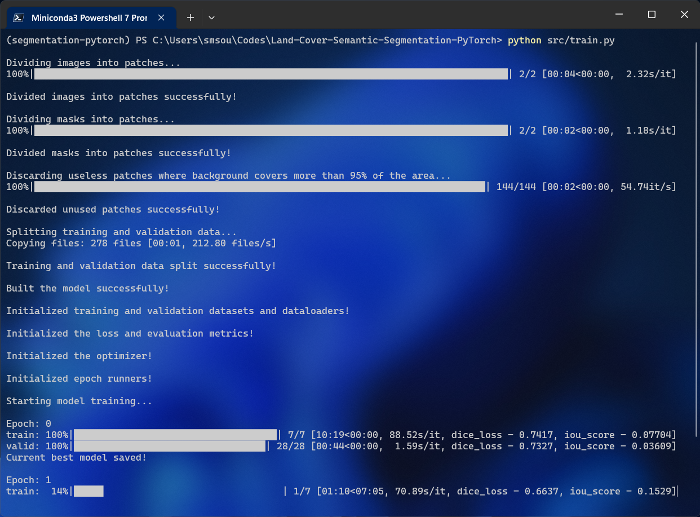
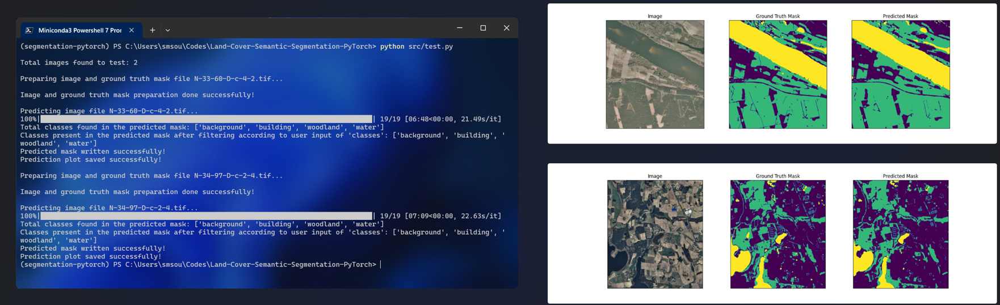
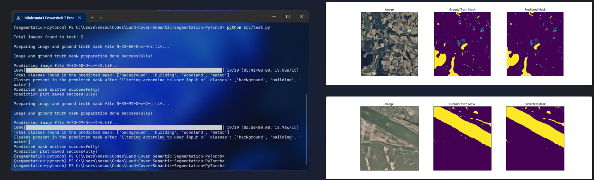

<div align="center">

<h1 align="center"><strong>🌍 LandCover Vision</strong></h1>
<h4 align="center">An end-to-end Land Cover Semantic Segmentation pipeline built with PyTorch</h4>


</div>

---

## 📚 Table of Contents
- [Overview](#overview)
- [Features](#features)
- [Model Architecture](#model-architecture)
- [Dataset](#dataset)
- [Project Structure](#project-structure)
- [Installation & Setup](#installation--setup)
- [Training](#training)
- [Evaluation](#evaluation)
- [Inference](#inference)
- [Configuration Reference](#configuration-reference)
- [Technologies Used](#technologies-used)
- [Demo](#demo)
- [Limitations & Future Work](#limitations--future-work)
- [Acknowledgements](#acknowledgements)
- [License](#license)

---

## 📌 Overview <a name="overview"></a>

**LandCover Vision** is a configurable, end-to-end semantic segmentation pipeline for satellite and aerial imagery. It is designed around the [LandCover.ai dataset](https://landcover.ai.linuxpolska.com/) but can be adapted to any pixel-level land-cover classification task.

A key feature of this project is **promptable class selection at inference time**: a model trained on a broad set of classes (e.g., all 5 LandCover.ai classes) can be queried at test time to produce output masks that include only a user-defined subset of classes — without retraining.

The entire pipeline — encoder choice, optimizer, learning rate schedule, patch size, class selection — is controlled through a single YAML configuration file.

---

## ✨ Features <a name="features"></a>

- **Config-driven pipeline** — all hyperparameters and paths managed in `config/config.yaml`
- **Promptable inference** — specify which classes to show in predictions via `test_classes` at test time
- **Patch-based sliding-window inference** — handles large satellite images gracefully with overlapping patch reconstruction
- **Flexible model architecture** — any SMP architecture + encoder combination supported
- **Multiple run modes** — `train.py`, `test.py` (with ground truth), `inference.py` (images only), `test_with_metrics.py` (full evaluation suite)
- **Rich evaluation metrics** — Pixel Accuracy, Mean IoU, mAP@50, mAP@75, Dice Coefficient, FW-IoU, per-class breakdowns saved as JSON/CSV
- **Rotating file logger** — structured logs for every training and evaluation run
- **Docker support** — containerised training and inference via `Dockerfile`

---

## 🏗️ Model Architecture <a name="model-architecture"></a>

The model is built using [segmentation_models_pytorch (SMP)](https://github.com/qubvel/segmentation_models.pytorch).

| Component | Default Value | Options |
|-----------|--------------|---------|
| Architecture | `Unet` | Any SMP model (UNet++, FPN, PSPNet, DeepLabV3+, …) |
| Encoder | `efficientnet-b0` | Any SMP-supported encoder (ResNet, EfficientNet, MobileNet, …) |
| Encoder Weights | `imagenet` | Pretrained ImageNet weights |
| Activation | `softmax2d` | `sigmoid` (binary), `softmax2d` (multi-class) |
| Loss | Dice Loss | — |
| Metric | IoU (threshold 0.5) | — |
| Optimizer | Adam | Any `torch.optim` optimizer |
| LR Scheduler | ReduceLROnPlateau | factor=0.5, patience=5 |

**Training workflow:**
1. Large images are split into non-overlapping patches (`patchify`)
2. Patches where background covers > `discard_rate` of pixels are discarded
3. Remaining patches are split 80/20 into train/val sets
4. Model is trained with Dice Loss + Adam + ReduceLROnPlateau
5. Best model by validation IoU is saved

**Inference workflow:**
1. Test image is padded to be divisible by `patch_size`
2. Image is divided into **overlapping** patches (step = `patch_size // 2`)
3. Each patch is preprocessed and passed through the model
4. Predicted patches are reassembled and unpadded
5. User-specified classes are filtered from the output mask

---

## 📂 Dataset <a name="dataset"></a>

This project is built for the **[LandCover.ai](https://landcover.ai.linuxpolska.com/)** dataset:
- High-resolution aerial imagery of Poland
- 5 land-cover classes:

| Class ID | Class Name |
|----------|------------|
| 0 | background |
| 1 | building |
| 2 | woodland |
| 3 | water |
| 4 | road |

**Download:** [LandCover.ai Official](https://landcover.ai.linuxpolska.com/) or [Kaggle Mirror](https://www.kaggle.com/datasets/adrianboguszewski/landcoverai)

After downloading, place files as:
```
data/
  train/
    images/   ← place training .tif images here
    masks/    ← place training .tif masks here
  test/
    images/   ← place test .tif images here
    masks/    ← place test .tif masks here (optional, needed for test.py)
```

---

## 🗂️ Project Structure <a name="project-structure"></a>

```
landcover-segmentation-pytorch/
├── assets/                          # Demo images and plots
├── config/
│   └── config.yaml                  # Main configuration file
├── data/
│   ├── train/
│   │   ├── images/                  # Training satellite images (.tif)
│   │   └── masks/                   # Training segmentation masks (.tif)
│   └── test/
│       ├── images/                  # Test images (.tif)
│       └── masks/                   # Ground truth test masks (.tif)
├── logs/                            # Training and evaluation log files
├── models/                          # Saved model weights (.pth)
├── notebooks/
│   └── training.ipynb               # Jupyter notebook for experimentation
├── output/                          # Predicted masks and visualizations
├── src/
│   ├── train.py                     # Model training script
│   ├── test.py                      # Test with ground truth masks (visualization)
│   ├── test_with_metrics.py         # Full evaluation with metrics (JSON + CSV)
│   ├── inference.py                 # Inference on images only (no GT masks)
│   └── utils/
│       ├── constants.py             # Project-wide constants and enums
│       ├── dataset.py               # PyTorch Dataset class for segmentation
│       ├── logger.py                # Rotating file logger setup
│       ├── patching.py              # Patch creation and useless patch discarding
│       ├── plot.py                  # Visualization utility
│       ├── preprocess.py            # Albumentations augmentation pipelines
│       └── root_config.py           # Root path and YAML config loader
├── Dockerfile                       # Docker container setup
├── LICENSE                          # MIT License
├── README.md                        # Project documentation
└── requirements.txt                 # Python dependencies
```

---

## 🚀 Installation & Setup <a name="installation--setup"></a>

### Prerequisites
- Python 3.9+
- pip or conda

### Clone the Repository
```bash
git clone https://github.com/22N31A05B2/landcover-segmentation-pytorch.git
cd landcover-segmentation-pytorch
```

### Create a Virtual Environment
**Using conda:**
```bash
conda create --name landcover-env python=3.9
conda activate landcover-env
```

**Using venv:**
```bash
python -m venv landcover-env
# Windows:
landcover-env\Scripts\activate
# Linux/Mac:
source landcover-env/bin/activate
```

### Install Dependencies
```bash
pip install -r requirements.txt
```

### Docker Setup
```bash
# Build image
docker build -t landcover-vision .

# Run (set to train or test in Dockerfile CMD)
docker run --name landcover-container -d landcover-vision

# Copy outputs
docker cp landcover-container:/segment_project/models ./models
docker cp landcover-container:/segment_project/logs ./logs
docker cp landcover-container:/segment_project/output ./output

# Cleanup
docker stop landcover-container
docker rm landcover-container
docker rmi landcover-vision
```

---

## 🏋️ Training <a name="training"></a>

1. **Download and place the dataset** in `data/train/images/` and `data/train/masks/` (see [Dataset](#dataset))
2. **Edit `config/config.yaml`** to set your desired classes, architecture, and hyperparameters
3. **Run training:**

```bash
cd src
python train.py
```

Training will:
- Create non-overlapping image patches
- Discard background-dominated patches (controlled by `discard_rate`)
- Split data 80/20 into train/validation
- Save the best model (by validation IoU) to `models/`
- Log progress to `logs/train.log`

**Key config options for training:**
```yaml
vars:
  train_classes: ['background', 'building', 'woodland', 'water']
  batch_size: 16
  epochs: 20
  model_arch: 'Unet'
  encoder: 'efficientnet-b0'
  optimizer_choice: 'Adam'
  init_lr: 0.0003
```

---

## 📊 Evaluation <a name="evaluation"></a>

### Test with Visualization (requires ground truth masks)
```bash
cd src
python test.py
```
Outputs: predicted mask `.tif` files and side-by-side comparison plots (image | GT mask | predicted mask) in `output/`.

### Full Evaluation with Metrics
```bash
cd src
python test_with_metrics.py
```
Outputs per-image and overall metrics including:
- Pixel Accuracy, Mean Pixel Accuracy
- Mean IoU, per-class IoU
- mAP@50, mAP@75
- Dice Coefficient (per-class and mean)
- Frequency Weighted IoU

Results saved to `output/metrics/test_metrics.json`, `test_metrics_summary.csv`, and `test_metrics_per_class.csv`.

**Promptable class selection at test time:**
```yaml
# In config/config.yaml — edit this before running test.py or test_with_metrics.py
vars:
  test_classes: ['background', 'building', 'water']   # only these classes in output
```

---

## 🔍 Inference <a name="inference"></a>

Run inference on images without ground truth masks:
```bash
cd src
python inference.py
```

Place test images in `data/test/images/` and configure:
```yaml
vars:
  test_classes: ['background', 'building', 'woodland', 'water']
  model_name: trained_landcover_unet_efficientnet-b0_epochs18_patch512_batch16.pth
```

Output: predicted mask files and visualizations in `output/`.

---

## ⚙️ Configuration Reference <a name="configuration-reference"></a>

All settings are in [`config/config.yaml`](config/config.yaml):

| Key | Default | Description |
|-----|---------|-------------|
| `file_type` | `.tif` | Image file extension |
| `patch_size` | `512` | Patch size for tiling |
| `discard_rate` | `0.95` | Max background fraction before patch is discarded |
| `batch_size` | `16` | Training batch size |
| `model_arch` | `Unet` | SMP model architecture |
| `encoder` | `efficientnet-b0` | Encoder/backbone |
| `encoder_weights` | `imagenet` | Pretrained weights source |
| `activation` | `softmax2d` | Output activation (`sigmoid` or `softmax2d`) |
| `optimizer_choice` | `Adam` | PyTorch optimizer name |
| `init_lr` | `0.0003` | Initial learning rate |
| `reduce_lr_by_factor` | `0.5` | LR reduction factor on plateau |
| `patience_epochs_before_reducing_lr` | `5` | Patience epochs before LR reduction |
| `epochs` | `20` | Total training epochs |
| `device` | `cpu` | `cpu` or `cuda` |
| `all_classes` | `['background', 'building', 'woodland', 'water', 'road']` | All dataset classes |
| `train_classes` | `['background', 'building', 'woodland', 'water']` | Classes to train on |
| `test_classes` | `['background', 'building', 'water']` | Classes to show in predictions |

---

## 🛠️ Technologies Used <a name="technologies-used"></a>

| Technology | Purpose |
|-----------|---------|
| [PyTorch 2.0+](https://pytorch.org/) | Deep learning framework |
| [segmentation_models_pytorch](https://github.com/qubvel/segmentation_models.pytorch) | UNet and encoder implementations |
| [Albumentations](https://albumentations.ai/) | Data augmentation |
| [OpenCV](https://opencv.org/) | Image I/O and processing |
| [patchify](https://github.com/dovahcrow/patchify.py) | Image patching and unpatching |
| [split-folders](https://github.com/jfilter/split-folders) | Train/validation dataset splitting |
| [scikit-learn](https://scikit-learn.org/) | Evaluation metrics |
| [NumPy](https://numpy.org/) | Numerical operations |
| [Matplotlib](https://matplotlib.org/) | Visualization |
| [PyYAML](https://pyyaml.org/) | Config file parsing |
| [tqdm](https://tqdm.github.io/) | Progress bars |
| [Docker](https://www.docker.com/) | Containerisation |

---

## 💫 Demo <a name="demo"></a>

**Training progress:**

<p align="center">
  
</p>

**Testing with all trained classes (`test_classes: ['background', 'building', 'woodland', 'water']`):**

<p align="center">
  
</p>

**Promptable inference with selected classes (`test_classes: ['background', 'building', 'water']`):**

<p align="center">
  
</p>

---

## ⚠️ Limitations & Future Work <a name="limitations--future-work"></a>

**Current limitations:**
- `road` class is included in `all_classes` but excluded from default training as it requires more fine-tuning
- CPU inference is slow on large images due to patch-by-patch processing
- No mixed-precision (AMP) training support yet
- Single pretrained model provided; users must train for custom datasets

**Planned improvements:**
- [ ] Add support for mixed-precision training (torch.cuda.amp)
- [ ] Multi-GPU / distributed training support
- [ ] Batch inference for faster test-time processing
- [ ] Support additional evaluation metrics (boundary F-score, panoptic quality)
- [ ] MLflow or W&B experiment tracking integration
- [ ] Model export to ONNX for deployment

---

## 👏 Acknowledgements <a name="acknowledgements"></a>

This project was built with reference to and inspired by the work of:

- **[souvikmajumder26/Land-Cover-Semantic-Segmentation-PyTorch](https://github.com/souvikmajumder26/Land-Cover-Semantic-Segmentation-PyTorch)** — the original open-source project that served as the primary reference for this implementation (MIT License)
- **[qubvel/segmentation_models.pytorch](https://github.com/qubvel/segmentation_models.pytorch)** — segmentation model library
  ```
  @misc{Iakubovskii:2019,
    Author = {Pavel Iakubovskii},
    Title = {Segmentation Models Pytorch},
    Year = {2019},
    Publisher = {GitHub},
    Journal = {GitHub repository},
    Howpublished = {\url{https://github.com/qubvel/segmentation_models.pytorch}}
  }
  ```
- **[LandCover.ai](https://landcover.ai.linuxpolska.com/)** — the aerial imagery dataset used for training and evaluation
- **[bnsreenu/python_for_microscopists](https://github.com/bnsreenu/python_for_microscopists)** — image segmentation tutorials and techniques

---

## 🚀 Push to GitHub

```bash
# Initialize fresh repository
git init
git add .
git commit -m "Initial commit: LandCover Vision - Land Cover Semantic Segmentation"
git branch -M main
git remote add origin https://github.com/22N31A05B2/landcover-segmentation-pytorch.git
git push -u origin main
```

---

## 🛡️ License <a name="license"></a>

This project is distributed under the [MIT License](LICENSE).

**Attribution note:** This project was developed with reference to [souvikmajumder26/Land-Cover-Semantic-Segmentation-PyTorch](https://github.com/souvikmajumder26/Land-Cover-Semantic-Segmentation-PyTorch) (MIT License, Copyright © 2023 Souvik Majumder). The original license and copyright are acknowledged above.

---

<p align="right">
  <a href="#top"><b>🔝 Back to top</b></a>
</p>
